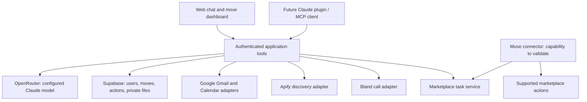

# Proposed architecture

This is a design proposal for an empty repository, not implemented functionality.

## Application shape

Use one TypeScript monorepo following [MONOREPO.md](MONOREPO.md).
The website lives at `web/` (teammate PR #1); shared domain/tools/contracts and integrations
live under `packages`. The requested Muse Code SDK runs through a separate worker
adapter; see [AGENT_STANDARDS.md](AGENT_STANDARDS.md). Vercel hosts the web UI and bounded
server requests. Supabase owns identity, durable records and private file storage.
The server calls an explicitly configured Claude model through OpenRouter after
verifying account/model availability and tool/image/PDF capabilities. Do not route
private documents to fallback providers without an explicit data-handling choice.

The product's runtime tools and the coding agents in `.claude/` and `.codex/`
are separate systems. The web demo does not require launching coding agents.

## Code boundaries

The canonical target tree and dependency rules are in [MONOREPO.md](MONOREPO.md).
Use `web/`, shared `packages/*` (extracted as needed), root `supabase/migrations`, the agent worker
and Muse connector. This supersedes the initial root `app/` / `lib/` proposal.

## State model

- `moves`: owner, origin/destination, move-in/out dates, timezone and status.
- `documents` / `lease_findings`: private file reference, page/quote, obligation,
  due-date calculation, uncertainty and confirmation status.
- `items` / `photos`: item/room identity, original private object, SHA-256, upload
  timestamp, claimed capture metadata, condition and confirmed associations.
- `tasks`: deadline, dependencies, owner and completion evidence.
- `conversations` / `messages`: user-scoped chat; avoid unnecessary raw tool payloads.
- `action_requests` / `action_events`: validated immutable action version,
  authorization, idempotency key, attempts, provider IDs and observed result.
- `listings` / `service_requests`: channel capabilities, drafts, quotes and references.
- `connections`: provider identity/scopes and encrypted server-only credential refs.
- Proposed additional entities: `contacts`, `offers`, `item_reservations` and
  `pickup_arrangements`. Keep item-level availability across all its listings and
  claim reservations atomically, not independently per channel.
- Track confirmed facts and their source/version. Changed dates, lease clauses or
  item condition produce a preview of affected tasks and drafts.

All user-facing records and storage access must enforce ownership. Links returned
to the model should be short-lived and limited to files required for the task.

## External-action contract

Proposed states:

`draft → awaiting_authorization → authorized → executing → confirmed | failed | unknown`

Cancellation/expiry are separate transitions. Recovery from `unknown` checks the
provider before retrying. Only one executor may claim an action at a time.

Action execution and business outcome are separate: sent email vs landlord agreement,
created event vs accepted appointment, published listing vs sale, placed call vs
booking, scheduled pickup vs completed handoff. A generic action `confirmed` must
not silently complete the associated business task.

Action fields: `id`, `move_id`, authenticated owner, `kind`, validated payload,
payload version/hash, authorization scope/expiry, idempotency key, provider,
provider reference, state and timestamped events. Approvals cannot authorize an
edited payload or a different recipient. Models cannot manufacture approval.

User-confirmed policy is "prepare freely; review sends, calls, posts and bookings."
Apply renter-serving scope checks before preparing disallowed workflows and again
at action entry points. Structured actor/purpose checks and adversarial tests
supplement model instructions. Connectors inherit identity, ownership and policy.

Execute short provider calls in bounded requests. Store long-running Apify/Bland
jobs durably and reconcile via authenticated callbacks or a scheduled worker.
Do not depend on memory or a serverless request remaining alive for a full call.
Select the worker/scheduler after checking actual provider and hosting limits.

## Muse bridge feasibility gate

Expose narrowly scoped task retrieval, claim, progress and completion operations
through a reviewed connector. These are our proposed operations, not existing
Meta endpoints. Validate whether Muse can initiate/poll tasks and execute the
specific marketplace action. A model API is not the user's personal Muse session.
Facebook Marketplace through Muse is the user's priority and live messaging is
the goal. This capability check is on the critical path. Verify posting, task
pickup and message access/reviewed replies independently; none is established yet.
Our server cannot guarantee constraints on direct Muse browser actions outside
our tools; use Muse's controls and verify outcomes before marking completion.
